# Knots Made Easy

See how knots are tied, step by step, with a physically simulated rope.

**[knots-made-easy.pages.dev](https://knots-made-easy.pages.dev)**

Pick a knot, press play and watch the rope tie itself. Scrub back and forth, jump between steps
and turn the view to see each crossing from any side. The rope isn't animated by hand: invisible
"hands" pull a few points of it along a path, and physics does the rest, so it sags, slides,
catches on itself and cinches like real rope.

Knots so far: overhand, figure-eight, bowline, clove hitch and zeppelin bend.

## The stargazer rope

Every GitHub star ties a knot. Star the repo and your face joins the rope, tied on with an overhand
or, for one stargazer in four, a figure-eight.

[](https://knots-made-easy.pages.dev/stargazers/)

Find your knot and its number on the [stargazer page](https://knots-made-easy.pages.dev/stargazers/).

## Run it

Needs Node 22.22 or newer and pnpm.

```bash
pnpm install
pnpm dev
```

| Command         | What it does                                                |
| --------------- | ----------------------------------------------------------- |
| `pnpm dev`      | Dev server                                                  |
| `pnpm test`     | Rope physics, playback and a bake fingerprint of every knot |
| `pnpm build`    | Type-check and prerender one page per knot                  |
| `pnpm test:e2e` | Playwright against the production build                     |
| `pnpm lint`     | oxlint                                                      |
| `pnpm format`   | oxfmt                                                       |

Built with React, React Router and three.js, with no physics library: the rope is a small
position-based rod simulation baked in a Web Worker while you watch. Hosted on Cloudflare Pages.
[AGENTS.md](AGENTS.md) explains how it fits together and how to add a knot.
